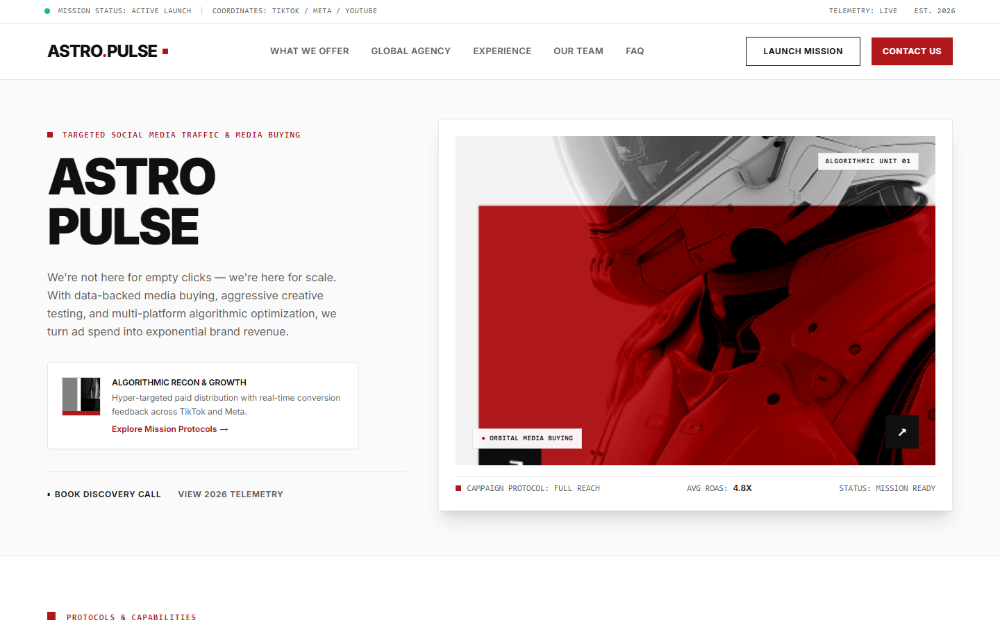
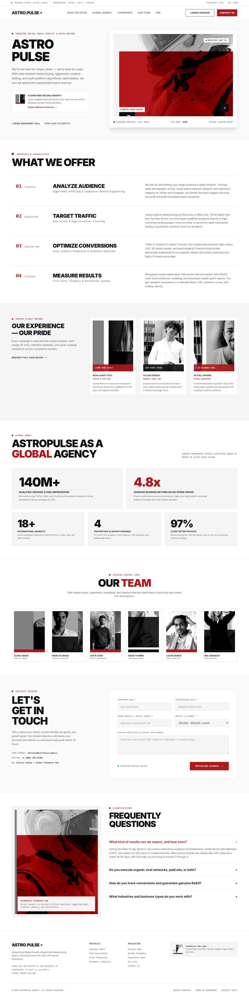
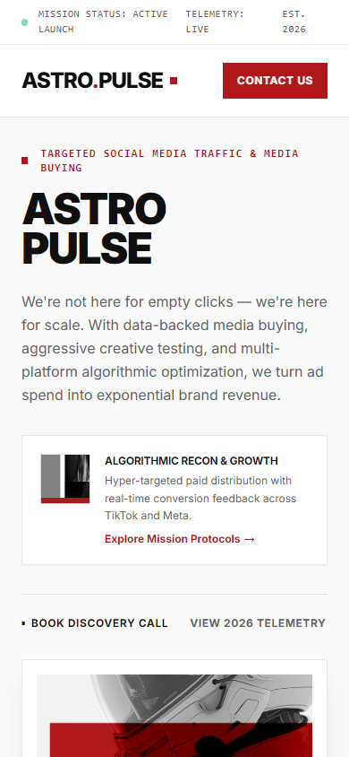

# ASTROPULSE AGENCY 🚀

> **Algorithmic Social Media Growth & High-Velocity Media Buying Agency**  
> Inspired by the award-winning brutalist-editorial space aesthetic of *Astro Traffic*.



---

## 🛰️ Overview

**ASTROPULSE AGENCY** is an aerospace-themed social media marketing agency concept designed for high-growth consumer brands, ecommerce giants, and venture-backed startups looking to scale on **TikTok, Meta (Instagram/Facebook), YouTube Shorts, and Paid Social**.

The design system blends editorial typography, technical grid telemetry, high-contrast monochrome photography, and aerospace crimson accents (`#AF181A`).

---

## ✨ Features & Sections

- **Live Telemetry Header:** Active launch mission coordinates, real-time status pulses, and quick navigation.
- **Hero Mission Terminal:** Monumental typography (`Inter 900`), astronaut suit focal point with crimson telemetry band, and interactive discovery actions.
- **01–04 What We Offer:** Numbered service protocols with deep technical descriptions:
  - `01 · ANALYZE AUDIENCE:` Algorithmic profiling, demographic scraping, and subculture trend mapping.
  - `02 · TARGET TRAFFIC:` Paid social media buying architectures on Meta & TikTok Ads.
  - `03 · OPTIMIZE CONVERSIONS:` Bespoke UGC production, 3D motion graphics, and 3-second hook testing.
  - `04 · MEASURE RESULTS:` Server-side Conversion APIs (CAPI) and multi-touch blended RoAS analytics.
- **Flight Record & Case Studies:** Monochromatic case cards with crimson RoAS telemetry badges (+340% RoAS, 42M Views, 5.2x RoAS).
- **Global Orbit Metrics:** Audited KPI dashboard blocks (`140M+` views, `4.8x` RoAS, `18+` markets, `4` AI engines, `97%` retention).
- **Mission Control Crew:** 6 specialized flight commanders with monochrome styling and technical badges.
- **Transmission Terminal (Contact):** Minimalist encrypted inquiry form with monthly ad budget selector.
- **Telemetry Clarifications (FAQ):** Interactive accordion with active crimson status indicators.
- **Footer Telemetry Seal:** HQ coordinates, technical sitemap, and security protocol audit links.

---

## 🎨 Design System & Palette

| Token | HEX | Role |
|---|---|---|
| **Astro Crimson** | `#AF181A` | Primary accent, status indicators, badges |
| **Deep Charcoal** | `#101010` | High-contrast typography, dark UI elements |
| **Laboratory White** | `#FFFFFF` | Base background, card surfaces |
| **Telemetry Gray** | `#F5F5F7` | Surface contrast, card containers, form inputs |
| **Grid Line** | `rgba(16, 16, 16, 0.1)` | Structural technical borders |

* **Typography:** `Inter` (Google Fonts: 300, 400, 500, 600, 700, 800, 900)
* **Design Brief:** Comprehensive 7-section specifications in [`DESIGN-BRIEF.md`](DESIGN-BRIEF.md).

---

## 📱 Full Page & Responsive Previews

### Desktop Full Experience


### Mobile Viewport


---

## 🛠️ Getting Started

Open `index.html` directly in any modern browser:

```bash
# Clone the repository
git clone https://github.com/vantdesigntech/astropulse-agency.git

# Navigate to project
cd astropulse-agency

# Open index.html in your browser
start index.html   # On Windows
open index.html    # On macOS
```

---

## 📄 License

MIT License © 2026 [vantdesigntech](https://github.com/vantdesigntech)
